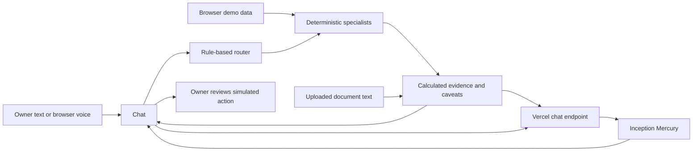

# BIz system reference

**Track:** AI Agents (`team.json`). **Status:** demonstration, not a production service or a collection of autonomous LLM agents.

BIz helps a shop or café owner explore operational questions in chat. The current implementation combines a rule-based router, deterministic business calculations and a model-written response. Its agent labels refer to software specialists, not independent LLMs. The model does not independently select tools, execute purchases or contact people.

## Data and provenance

The Meltado scenario is an independent simulation, not a connection to the café or an endorsement. Twelve item names and listed prices are a [public menu snapshot](https://www.zomato.com/ncr/meltado-1-karkardooma-new-delhi/order), accessed 18 November 2026; they are not a complete or guaranteed-current menu. All sales quantities, costs, inventory, staff, customers, suppliers, charts and actions are fictional. There is no documented merchant interview or verified business outcome.

## Deployed chat architecture

1. `app/main.js` receives the question. When a document is active, it uses extracted document text and, where available, a deterministic CSV calculation instead of the simulated shop figures.
2. For normal demo questions, `app/agent.js` uses keyword rules and `getIntent` to select one or more specialists. Chat currently calls the orchestrator without a model classifier. Rules can miss requests or match the wrong specialist.
3. `app/engine.js` and `app/meltado.js` generate the relevant calculations and caveats. `api/chat.js` sends the question, up to six recent messages and the selected evidence to Inception Mercury, which generates a response and an estimated sentiment label for the current message.
4. The browser displays the model response and, for supported shop queries, the original calculated evidence. Model text may still misstate figures; the source figures are provided for checking. On an API error or malformed output, the chat identifies the fallback and shows local evidence where available. If there is no calculation for an uploaded document, it asks the user to retry rather than claiming to have analysed it.
5. Suggested messages are editable simulations. The interface does not send WhatsApp messages, place orders or make payments.

The separate local `/api/intent` and hosted `api/intent.js` endpoints can classify labels, and the orchestrator accepts an optional classifier. They are **not** used by the current main chat path. The experimental Meta and Twilio adapters are separate services, use seed data, and are not connected to the deployed chat.

## Specialists and calculations

The specialists are deterministic handlers in `app/engine.js` and `app/meltado.js`:

| Specialist | Operation | Limits |
|---|---|---|
| Sales | Compares today's sales with a previous value; handles a zero comparison. | The comparison does not explain the cause and revenue is not profit. |
| Cash and UPI | Compares expected and observed amounts separately. | A difference may reflect settlement timing or entry errors; it is not evidence of wrongdoing. |
| Inventory | Computes stock ÷ daily use, flags less than three days, and estimates a seven-day reorder rounded to packs. | Assumes usage continues and excludes pending orders and changing demand. It returns the first flagged item, which may not be the one asked about. |
| Udhaar | Sums receivables and identifies an older balance for a suggested reminder. | Cannot verify current payments or real credit terms. |
| Staff | Displays fictional roles and attributed sales where present. | Does not rate employees or measure productivity. |
| Menu | Selects the highest sample item revenue from price × units. | Does not establish actual popularity, margin or real café sales. |
| Finance | Computes sample revenue minus assumed ingredient costs. | Contribution is not net profit and excludes other costs and taxes. |

For the sample milk case, 8 L ÷ 5 L/day = 1.6 days of cover. The suggested order is 30 L, based on a seven-day target, five-litre packs and the sample assumptions. Money display in these specialists is rounded to whole rupees; this is not an accounting or tax system.

## Document analysis

The upload interface accepts CSV, plain text, Markdown and text-based PDFs up to 2 MB. PDF.js is loaded from a public CDN to extract up to 20 pages. At most 12,000 characters are provided to the model; the response identifies when content is truncated. Scanned PDFs, OCR and Excel are not supported. An active upload stays in browser memory until removed or the session is lost and does not update the Meltado dashboard.

For a compatible CSV with a single recognized sales amount column, the browser separately calculates a total using integer paise; other CSV shapes can still be analysed by the model without a verified total. The user must check column meaning, period, taxes and duplicates. Document text, questions, conversation excerpts and relevant evidence are sent to Inception. Treat model-generated interpretations and arithmetic as unverified unless a separate deterministic calculation is shown.

## State, voice and security

- Sample shop edits, activity and simulated approvals are stored in browser localStorage. They are user-editable and not an audit log; separate devices and messaging adapters do not share them.
- Speech recognition and synthesis depend on browser support and permissions. Audio may be processed by the browser provider; typing is the fallback.
- The public deployment has no user authentication or durable rate limiting. Its server-side Inception key is not exposed in frontend source, but public users can consume its API quota. It is not suitable for sensitive business data or production use without further safeguards.
- The system prompt asks the model to treat documents as data and avoid inventing facts, but prompt injection and incorrect answers remain possible. Sentiment is an uncertain estimate and must not be used to judge staff or diagnose mental health.
- Meta and Twilio adapters have signature and allowlist checks in their separate implementations, but there is no verified end-to-end WhatsApp delivery in the deployed app. In-memory deduplication is not durable.

## Run and inspect

Run `npm install`, then `npm run dev`; open `/` for chat and `/dashboard.html` for the workspace. The local server forwards `/api/chat` to the hosted endpoint. Run `npm test` for unit tests and `npm run build` for static assets. The Vercel deployment additionally uses the `api/` functions and a sensitive `INCEPTION_API_KEY` environment variable. Never commit credentials.

Try a cash or inventory question, compare the calculated evidence with the response, and inspect a simulated draft. Upload a small document to try document analysis. The live app and tests demonstrate a prototype; they do not establish financial correctness, reliable sentiment classification, merchant impact or production readiness.
