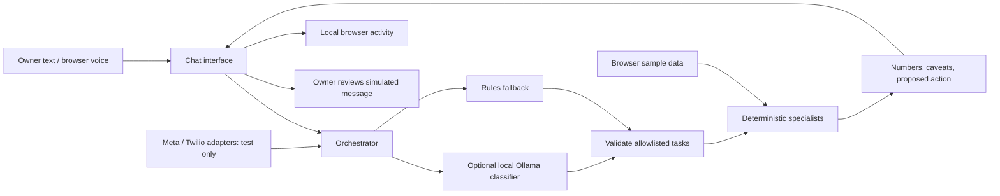

# BIz agent system reference

**Version:** Hackathon prototype, 18 November 2026. **Track:** Physical World. This document describes the implementation in this repository, not a production system or a set of independently autonomous LLM agents.

## Product and evidence

Small café owners must reconcile several operational signals while running the shop. BIz demonstrates a conversational interface that routes questions to bounded specialists, computes basic metrics and proposes an action for human review. The dashboard provides the same simulated shop data and displays the routing structure.

Meltado is a public-menu-inspired demonstration, not a partnership or a connection to its systems. Twelve selected item names and listed prices were taken from the [Karkardooma online menu](https://www.zomato.com/ncr/meltado-1-karkardooma-new-delhi/order); prices may have changed or vary by channel. Sales, costs, stock, staff, transactions, customer names, suppliers and charts are fictional. No representative customer interview or production outcome has been verified.

## Architecture and trust boundaries

Classifier receives the question, not shop data. Voice recognition may use a browser provider's remote service. Dashboard and chat read/write browser localStorage; the separate messaging adapters use the static seed and do not read browser edits. Static hosting has no Node/Ollama endpoint and falls back to rules. The dashboard model status is an availability check, not proof a particular answer used the model.

## Component contracts

| Component | Input → output | Implementation and tools | Boundaries and failure behavior |
|---|---|---|---|
| Voice interface | Microphone → browser transcript → question; answer → browser speech | Browser `SpeechRecognition` and `speechSynthesis` in `app/main.js` | Browser/permission/network dependent; audio may leave device. No WhatsApp voice-note transcription. Typed fallback. |
| Classifier | Question → JSON `{tasks:[...]}` | `POST /api/intent` in `server.js`; local `qwen2.5-coder:7b` by default, 30-second timeout | Model only chooses labels; response is allowlisted, deduplicated and capped. Model can choose wrong labels; prompt injection and language coverage are not comprehensively evaluated. |
| Fallback planner | Question → task labels | `fallbackPlan` regexes in `app/agent.js` | Runs even when classifier returns labels; false positives and missed synonyms possible. No intent → unsupported response. |
| Orchestrator | Question + data + cases + optional classifier → tasks, source and results | `orchestrate` in `app/agent.js`; invokes deterministic handlers through `respond` | Merges model and rules; `Promise.all` runs functions, not independent autonomous agents. `source` records model if it produced any valid label, even if rules added others. |
| Action generator | Shop inputs → evidence cards and drafts | `makeCases` in `app/engine.js` | Recommendations are heuristic; drafts are simulated. No actual purchase, payment or employee action. |
| Dashboard/activity | Browser state → metrics, chart, run records | `app/dashboard.js`, `app/cafe-sections.js`, `app/state.js` | localStorage is per-browser, unencrypted and user-editable; not an audit-grade log. No live business connection. |
| WhatsApp Cloud adapter | Signed Meta webhook → answer → Cloud API text reply | `whatsapp/server.js`, `whatsapp/bot.js`; signature, allowlist, receiving number, in-memory dedupe | Prepared and locally tested; no live Meta setup. Sample seed only; voice notes unsupported. In-memory dedupe resets on restart and is not durable. |
| Twilio adapter | Signed form webhook → TwiML response | `twilio/server.js`, `twilio/handler.js`; Twilio SDK verification, allowlist | Inbound test reached BIz but the limited trial did not deliver direct reply; direct REST test returned 21654. No working real WhatsApp demo established. |

## Specialist cards

All specialist results are deterministic functions over supplied values. They do not call an LLM or act independently. See `app/engine.js`, `app/meltado.js` and `app/agent.js`.

| Specialist | Input and operation | Example with sample data | What it does not know |
|---|---|---|---|
| Sales | Compare `today` and `previous`; `(today / previous - 1) × 100`; handles zero baseline | ₹33,470 vs ₹30,458 ≈ +9.9% | Why a change happened; revenue is not profit. |
| Cash & UPI | Expected − observed separately for cash and UPI; positive = short, negative = over | Cash ₹750 short; UPI ₹1,600 short | Pending settlements, timing, mistakes; does not imply theft. |
| Inventory | Cover = stock ÷ daily usage; flag `<3` days. Reorder = max(pack, ceil((7×daily − stock)/pack)×pack) | Milk 8 L ÷ 5 L/day = 1.6 days; 30 L in 5 L packs, assumed ₹1,950 | Demand variation, expiry, lead time, supplier confirmation and pending orders. |
| Udhaar | Sum all balances; choose largest balance with age ≥7 days | Total ₹8,000; sample office order ₹4,800 at 12 days | Actual ledger, credit terms, recent settlement. |
| Staff | Display names, roles and attributed sales where present | Three fictional roles; no performance ranking | Shifts, tasks, fairness, productivity, working conditions. Never infer wrongdoing. |
| Menu | Sort sample items by `price × units`, return first | Classic Cold Coffee ₹3,720 = 31 × ₹120 | Actual sales, availability, discounts; “top” means gross revenue among sampled items, not units or margin. |
| Finance | Sum menu revenue and assumed ingredient cost; subtract for contribution | ₹33,470 − ₹13,907 = ₹19,563 | Real recipes, VAT/GST treatment, discounts, delivery fees, waste, financing. Not net profit. |

## Operational behavior and caveats

- Editing cash/UPI, milk stock and first receivable in the chat updates this browser’s stored sample and recalculates cases. It does not change messaging seed data or the menu quantities.
- Suggested WhatsApp/email drafts can be edited and marked simulated. No external communication occurs from the UI.
- The stock answer returns the first flagged stock case, not necessarily the particular item asked for. A no-alert response does not mean every product is in stock.
- Money display rounds to whole rupees; intermediate values are JavaScript numbers. The prototype is not suitable for accounting or tax decisions.
- The dashboard's sample remainder excludes taxes, fees, waste, financing and other missing costs. Never present it as real profit.
- No user authentication, multi-tenant storage, live POS import, production secret manager, durable queue, or real WhatsApp voice exists.

## Run and demonstrate

`npm install` (needed for Twilio tests); `npm run dev`; visit `/dashboard.html` or `/`. Run Ollama separately for optional classification; otherwise rules fallback. `npm test` runs unit tests; `node docs/evaluate.mjs` runs the small curated fallback routing set. Use fabricated data only.

1. Open dashboard: explain sample-data banner and public price provenance.
2. Inspect the seven-day chart and show the menu breakdown; note historical totals are synthetic.
3. Open chat and ask “cash and inventory”; explain the classifier and two specialists.
4. Inspect milk calculation and caveat; review a draft and explicitly show simulation confirmation.
5. Change milk remaining from 8 to 4 litres, ask again, then return to the dashboard. Expected cover becomes 0.8 day, assuming 5 litres/day.
6. Explain local browser storage, supported questions, and current WhatsApp limitation.

Meta's webhook requires a properly configured app and HTTPS endpoint; Twilio's limited trial rejected our direct custom message. Never display or commit `.env`, auth tokens or personal phone numbers. Do not expose a local tunnel to live sensitive data.

## Current deployed chat path (November 18 update)

The deployed chat uses deterministic rules to select specialist calculations. It sends the user's question, up to six recent messages and the selected evidence to `/api/chat`; the protected Vercel function calls Inception Mercury for a natural-language answer and a coarse sentiment label for the current message. The browser renders the original evidence separately. The model is prompted not to invent figures or execute actions, but this is not a formal guarantee. On missing access, upstream failure or malformed output, the chat labels the rules-based fallback. Uploading a CSV does not update the café dataset; when explicitly asked about that file with AI enabled, its calculated summary is sent as evidence. This current path supersedes earlier local-classifier-only descriptions where they conflict. The model does not autonomously invoke specialists or execute external actions.
